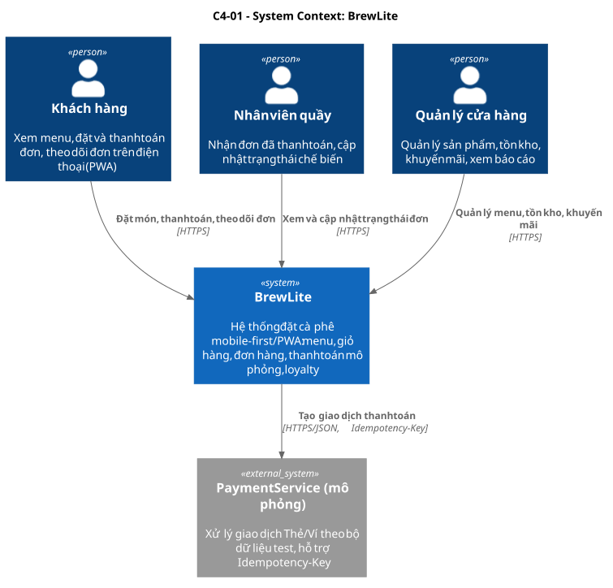
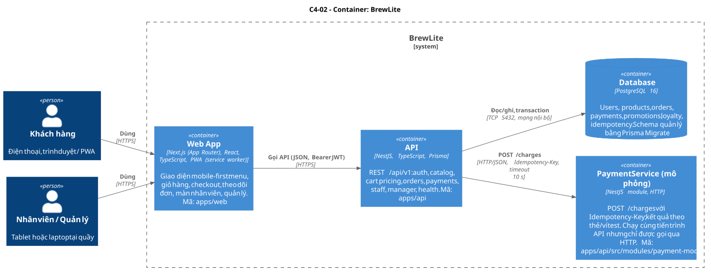
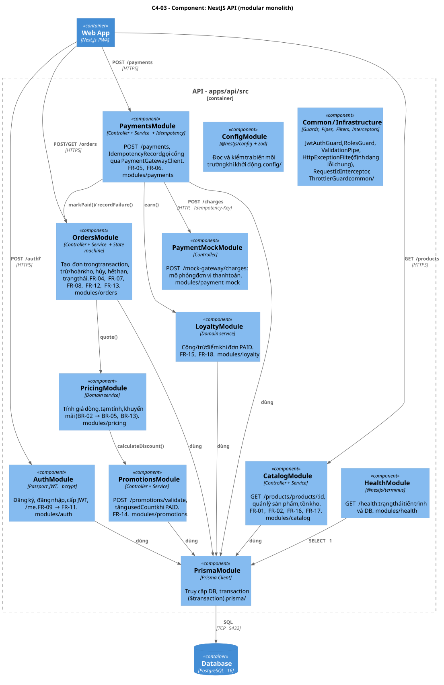

# BrewLite – Mô tả kiến trúc (Task 3.1)

| Thuộc tính | Giá trị |
|---|---|
| Tài liệu | `docs/architecture/architecture.md` |
| Phiên bản | 1.0 |
| Ngày | 2026-11-02 |
| Đầu vào | [SRS](../requirements/srs.md) · [Sơ đồ Task 2](../diagrams/README.md) |
| Quyết định | [ADR](adr/README.md) · [Deployment view](deployment-view.md) |

## 1. Phương pháp

Kiến trúc được mô tả theo **mô hình C4** ở ba mức. Bên trong mỗi module backend dùng **kiến trúc phân lớp**.

| Mức | Sơ đồ | Trả lời câu hỏi |
|---|---|---|
| C4-01 System Context | [c4-context.puml](diagrams/c4-context.puml) | Ai dùng BrewLite và nó nói chuyện với hệ thống ngoài nào? |
| C4-02 Container | [c4-container.puml](diagrams/c4-container.puml) | Hệ thống gồm những khối triển khai được nào, giao tiếp ra sao? |
| C4-03 Component (API) | [c4-component-api.puml](diagrams/c4-component-api.puml) | Backend chia module theo domain như thế nào? |
| Deployment-01 | [deployment.puml](diagrams/deployment.puml) | Các container chạy ở đâu trong local, CI và production? |







## 2. Động lực kiến trúc

Các yêu cầu chi phối mạnh nhất tới thiết kế:

| Mã | Động lực | Ảnh hưởng tới kiến trúc |
|---|---|---|
| C1 | Bắt buộc Next.js, NestJS, PostgreSQL | Ba container chính cố định |
| C9, C11 | 0 đồng, một người làm | Modular monolith thay vì microservices; dùng nền tảng có gói miễn phí |
| NFR-13, BR-07 | Không bán vượt kho, không ghi nửa vời | Trừ kho bằng `UPDATE … WHERE stock >= qty` trong transaction DB |
| FR-06, BR-10, BR-11 | Không trừ tiền hai lần | Bảng `idempotency_records` + unique index; Payment Service mô phỏng cũng idempotent |
| NFR-04 → NFR-08 | Bảo mật | JWT, bcrypt, validate whitelist, Helmet, rate limit, CORS, secret qua biến môi trường |
| NFR-09, NFR-11 | Mobile-first, PWA | Next.js App Router + service worker |
| NFR-14 → NFR-17 | Health check, Docker, CI/CD | `/health`, mỗi app có Dockerfile, image lên GHCR, deploy tự động |
| NFR-19 | Logging | Log JSON có `requestId`, che dữ liệu nhạy cảm |

## 3. Các container

| Container | Công nghệ | Trách nhiệm | Mã nguồn |
|---|---|---|---|
| **Web App** | Next.js (App Router), React, TypeScript, TanStack Query, Zustand, Serwist (PWA), Tailwind CSS | Toàn bộ giao diện: khách, nhân viên, quản lý | `apps/web` |
| **API** | NestJS, TypeScript, Prisma, Passport JWT, nestjs-pino, @nestjs/terminus | REST `/api/v1`, nghiệp vụ, transaction | `apps/api` |
| **Payment Service (mô phỏng)** | Module NestJS `PaymentMockModule`, HTTP | Mô phỏng đơn vị thanh toán: `POST /mock-gateway/charges` | `apps/api/src/modules/payment-mock` |
| **Database** | PostgreSQL 16 | Lưu trữ bền vững | Schema: `apps/api/prisma/schema.prisma` |
| (thư viện) **Shared** | TypeScript, zod | Schema validate và kiểu DTO dùng chung web/API | `packages/shared` |

## 4. Frontend – Next.js / PWA

| Khía cạnh | Thiết kế |
|---|---|
| Định tuyến | App Router. Khách: `/`, `/products/[id]`, `/cart`, `/checkout`, `/orders`, `/orders/[id]`, `/login`, `/register`. Nhân viên: `/staff`. Quản lý: `/manager/products` |
| Render | Trang menu dùng Server Component để tải nhanh (LCP, NFR-02); phần tương tác (giỏ, checkout) là Client Component |
| Dữ liệu server | TanStack Query: cache, retry, trạng thái loading/error (AC-01.3); theo dõi đơn bằng polling 3 giây (ADR-007) |
| Giỏ hàng | Zustand + `localStorage`: giữ giỏ khi tải lại và khi đăng nhập (AC-03.4) |
| Form, validate | react-hook-form + schema zod từ `packages/shared`: cùng quy tắc với backend (NFR-05) |
| Xác thực | JWT trong header `Authorization`; 401 thì chuyển `/login?returnUrl=…` (ADR-006) |
| PWA | Serwist: manifest, icon 192/512, precache tài nguyên tĩnh, cache menu theo *stale-while-revalidate*, **không cache** `/orders`, `/payments`, `/auth`; trang offline (NFR-11) |
| Idempotency phía client | Sinh `Idempotency-Key` (UUID v4) khi bấm thanh toán, giữ trong `sessionStorage` tới khi có kết quả cuối để gửi lại đúng khóa (FR-06) |

## 5. Backend – NestJS chia module theo domain

### 5.1 Module

| Module | Endpoint chính | Yêu cầu |
|---|---|---|
| `AuthModule` | `POST /auth/register`, `POST /auth/login`, `GET /me` | FR-09, FR-10, FR-11 |
| `CatalogModule` | `GET /products`, `GET /products/:id`, `/manager/products` | FR-01, FR-02, FR-16, FR-17 |
| `PricingModule` | (nội bộ) `quote(items, promoCode)` | BR-02 → BR-05, BR-13, FR-14 |
| `OrdersModule` | `POST /orders`, `GET /orders`, `GET /orders/:id`, `POST /orders/:id/cancel`, `/staff/orders` | FR-04, FR-07, FR-08, FR-12, FR-13 |
| `PaymentsModule` | `POST /payments` | FR-05, FR-06 |
| `LoyaltyModule` | `GET /me/loyalty`, (nội bộ) `earn()` | FR-15, FR-18 |
| `PromotionsModule` | `POST /promotions/validate` | FR-14 |
| `PaymentMockModule` | `POST /mock-gateway/charges` | Payment Service mô phỏng |
| `HealthModule` | `GET /health` | NFR-14 |
| `PrismaModule`, `ConfigModule`, `common/` | — | Hạ tầng dùng chung |

### 5.2 Phân lớp trong mỗi module

```
Controller   – nhận HTTP, DTO + ValidationPipe, Guard (JWT, Role); không chứa nghiệp vụ
   ↓
Service      – nghiệp vụ, mở transaction (prisma.$transaction), gọi service module khác
   ↓
Domain logic – hàm thuần, không I/O: PricingService.quote, OrderStateMachine.canTransition,
               Promotion.calculateDiscount → unit test dễ (NFR-18)
   ↓
Prisma       – truy cập dữ liệu (repository mỏng qua Prisma Client)
```

Quy tắc phụ thuộc:
- Module chỉ gọi module khác qua service đã export, không đọc thẳng bảng của module khác. Ngoại lệ có chủ đích: `OrdersService` trừ kho bằng `CatalogService.decreaseStock(tx, …)`, dùng **cùng transaction client** để đảm bảo BR-07.
- Không có vòng phụ thuộc: `Payments → Orders → Pricing`, `Payments → Loyalty`.

### 5.3 Cấu trúc thư mục dự kiến

```
apps/api/
├── prisma/
│   ├── schema.prisma
│   ├── migrations/            # sinh bởi prisma migrate, được commit
│   └── seed.ts                # dữ liệu mẫu, chạy lại được (upsert)
├── src/
│   ├── main.ts                # bootstrap: helmet, CORS, prefix /api/v1, pino
│   ├── app.module.ts
│   ├── config/                # zod schema cho biến môi trường
│   ├── common/                # guards, pipes, filters, interceptors
│   └── modules/
│       ├── auth/  catalog/  pricing/  orders/  payments/
│       ├── loyalty/  promotions/  payment-mock/  health/
│       └── prisma/
└── test/                      # e2e test của API (supertest)
```

### 5.4 Thành phần dùng chung (cross-cutting)

| Thành phần | Hành vi |
|---|---|
| `HttpExceptionFilter` | Mọi lỗi trả `{ statusCode, code, message, details, requestId }`; 5xx không lộ stack trace (NFR-19) |
| `ValidationPipe` | `whitelist`, `forbidNonWhitelisted`, `transform` (NFR-05) |
| `JwtAuthGuard`, `RolesGuard` | Kiểm tra JWT, vai trò `CUSTOMER`/`STAFF`/`MANAGER` (FR-11) |
| `ThrottlerGuard` | 5 lần/phút cho `/auth/login`, 100 request/phút/IP chung (NFR-08) |
| `RequestIdInterceptor` | Nhận hoặc sinh `x-request-id`, gắn vào log và response |
| Helmet, CORS | CORS chỉ cho `CORS_ORIGIN` (domain Vercel) |

## 6. Cơ sở dữ liệu và migration

| Khía cạnh | Thiết kế |
|---|---|
| DBMS | PostgreSQL 16 (local: container `postgres:16`; production: Render PostgreSQL) |
| ORM, migration | **Prisma** (ADR-004). Migration SQL trong `apps/api/prisma/migrations`, được review qua PR |
| Local | `prisma migrate dev` sinh migration; `prisma db seed` nạp dữ liệu mẫu |
| Production | `prisma migrate deploy` chạy **khi container khởi động**, trước khi nhận request. DB không public nên CI không chạy migration trực tiếp được (xem Deployment-01) |
| An toàn migration | Quy tắc *expand → contract*: chỉ thêm cột/bảng (có default hoặc nullable) trong một release; xóa hoặc đổi tên ở release sau, khi code cũ đã ngừng dùng. Nhờ vậy rollback về image trước không bị vỡ schema |
| Ràng buộc toàn vẹn | `CHECK (stock >= 0)`; unique `users.email`, `orders.code`, `promotions.code`; **partial unique** `payments(order_id) WHERE status = 'SUCCEEDED'` (BR-10); unique `idempotency_records(user_id, key)` (BR-11); unique `loyalty_transactions(order_id, type)` (BR-14) |
| Bảng | Theo Class-01: `users`, `categories`, `products`, `product_sizes`, `toppings`, `product_toppings`, `orders`, `order_items`, `order_item_toppings`, `order_status_history`, `payments`, `idempotency_records`, `promotions`, `loyalty_transactions`, `mock_charges` (riêng của PaymentMockModule) |

## 7. Dịch vụ thanh toán mô phỏng

| Khía cạnh | Thiết kế |
|---|---|
| Vị trí | Module `PaymentMockModule` chạy **cùng tiến trình** với API nhưng có **ranh giới HTTP** (ADR-005) |
| Hợp đồng | `POST /mock-gateway/charges` với header `Idempotency-Key`, body `{ amount, currency, method, source, reference }` → `{ transactionId, status, failureCode? }` |
| Gọi từ API | `PaymentGatewayClient` (HTTP, timeout 10 giây) tới `PAYMENT_GATEWAY_URL`. Đổi sang cổng thật hoặc service tách riêng chỉ cần đổi URL và adapter |
| Kết quả | Theo bảng dữ liệu test của SRS mục 3.1. Thẻ `…0119` chờ 15 giây ở lần đầu để tạo timeout |
| Idempotency | Lưu giao dịch vào bảng `mock_charges` theo khóa; gọi lại cùng khóa trả cùng kết quả, kể cả sau khi khởi động lại |
| Bảo mật | Chỉ nhận số thẻ qua HTTPS, không ghi log, không lưu số đầy đủ |

## 8. Logging, health check và cấu hình

| Khía cạnh | Thiết kế |
|---|---|
| Logging | `nestjs-pino`: log JSON một dòng mỗi request gồm `requestId`, method, path, status, `responseTime`; `redact` các trường `authorization`, `password`, `card.number`, `card.cvv`. Production: xem ở Render Logs và Vercel Runtime Logs (ADR-008) |
| Health check | `GET /health` (`@nestjs/terminus`): `SELECT 1` tới DB, trả `200 {status:"ok", db:"up"}` hoặc `503`. Dùng cho Docker `HEALTHCHECK`, Render health check và smoke test |
| Cấu hình | 12-factor: mọi cấu hình qua biến môi trường. `ConfigModule` kiểm tra bằng zod khi khởi động, thiếu biến thì **không khởi động** (fail fast). `.env.example` liệt kê đủ biến, không có giá trị thật |

Biến môi trường:

| Biến | App | Ví dụ / ghi chú |
|---|---|---|
| `DATABASE_URL` | api | `postgresql://…` – secret |
| `JWT_SECRET` | api | ≥ 32 byte ngẫu nhiên – secret |
| `JWT_EXPIRES_IN` | api | `3600` |
| `CORS_ORIGIN` | api | `https://brewlite.vercel.app` |
| `PAYMENT_GATEWAY_URL` | api | `http://localhost:4000/api/v1/mock-gateway` |
| `PAYMENT_TIMEOUT_MS` | api | `10000` |
| `PAYMENT_MOCK_ENABLED` | api | `true` – bật `PaymentMockModule` (ADR-005) |
| `PORT` | api | Render cấp `10000`; local `4000` |
| `LOG_LEVEL` | api | `info` |
| `NEXT_PUBLIC_API_URL` | web | `https://brewlite-api.onrender.com/api/v1` |

## 9. Lý do chọn, ưu điểm, hạn chế và trade-off

### 9.1 Vì sao modular monolith

| Tiêu chí | Modular monolith (chọn) | Microservices |
|---|---|---|
| Công sức cho 1 người, 2 Sprint | Thấp: một repo, một API, một DB | Cao: nhiều service, nhiều pipeline |
| Transaction đơn + kho + thanh toán | Transaction DB cục bộ, đơn giản, đúng (NFR-13) | Cần saga/outbox, khó đúng |
| Chi phí hạ tầng | 1 web service + 1 DB | Nhiều service, vượt gói miễn phí |
| Mở rộng độc lập | Hạn chế, scale cả khối | Tốt |
| Khả năng tách sau này | Có: module có ranh giới rõ, Payment đi qua HTTP | — |

### 9.2 Ưu điểm

- Đơn giản, hợp quy mô một quán và một người phát triển. Luồng chính dùng transaction DB nên dễ đảm bảo không bán vượt kho và không trừ tiền hai lần.
- Ranh giới module rõ, domain logic thuần nên dễ unit test.
- Mỗi thành phần trong deployment đều truy vết được tới mã nguồn ([deployment-view.md](deployment-view.md)).
- Chạy local bằng một lệnh `docker compose up`.

### 9.3 Hạn chế

- API và Payment Service mô phỏng chạy chung một tiến trình: API sập thì "cổng thanh toán" cũng sập. Chấp nhận được vì đây là mô phỏng.
- Gói miễn phí của Render cho ngủ dịch vụ sau 15 phút không có request: lần gọi đầu chậm 30–60 giây (R8).
- Theo dõi đơn bằng polling tốn request hơn SSE/WebSocket.
- Frontend và API khác domain nên cần CORS, và JWT phải lưu phía client (xem ADR-006).

### 9.4 Trade-off chính

| Quyết định | Được | Mất | ADR |
|---|---|---|---|
| Monorepo pnpm | Chia sẻ schema, một PR cho thay đổi xuyên tầng | CI phải lọc theo thư mục | [001](adr/001-monorepo.md) |
| Modular monolith NestJS | Transaction đơn giản, ít hạ tầng | Scale cả khối | [002](adr/002-modular-monolith-nestjs.md) |
| Next.js App Router + PWA | SSR nhanh, cài được lên màn hình | Service worker phức tạp hơn SPA thuần | [003](adr/003-nextjs-pwa-frontend.md) |
| Prisma + migrate khi khởi động | Migration có version, chạy được dù DB không public | Phải tuân thủ expand/contract | [004](adr/004-prisma-migrations.md) |
| Payment mock cùng tiến trình, ranh giới HTTP | 0 chi phí, không cold start riêng | Không độc lập về lỗi | [005](adr/005-payment-mock-service.md) |
| JWT Bearer, 60 phút | Đơn giản, hợp CORS khác domain | Không thu hồi token sớm được; rủi ro XSS nếu lộ | [006](adr/006-jwt-authentication.md) |
| Polling 3 giây | Chạy ổn trên mọi nền tảng, dễ test | Nhiều request hơn | [007](adr/007-order-status-polling.md) |
| Log JSON + `/health` + config zod | Dễ điều tra, fail fast | Thêm phụ thuộc | [008](adr/008-logging-health-config.md) |
| Vercel + Render + GHCR | HTTPS, CDN sẵn; DB nội bộ | Cold start; Postgres free hết hạn 30 ngày | [009](adr/009-deployment-vercel-render.md) |

## 10. Truy vết kiến trúc

| Container / thành phần | Yêu cầu chính | Sơ đồ Task 2 | Node deployment |
|---|---|---|---|
| Web App | FR-01 → FR-03, FR-07, FR-08, NFR-09 → NFR-12 | Activity-01 (làn Next.js UI), Sequence-01 | Vercel Edge Network / Functions |
| API – OrdersModule | FR-04, FR-12, FR-13, NFR-13 | Sequence-01 giai đoạn 1, State-01 | Render Web Service |
| API – PaymentsModule | FR-05, FR-06 | Sequence-01 giai đoạn 2 | Render Web Service |
| Payment Service mô phỏng | FR-05, FR-06 | Lifeline Payment Service | Render Web Service (cùng container) |
| Database | NFR-13, BR-07, BR-10, BR-11 | Class-01 | Render PostgreSQL |
| HealthModule | NFR-14 | — | Render health check, smoke test |
