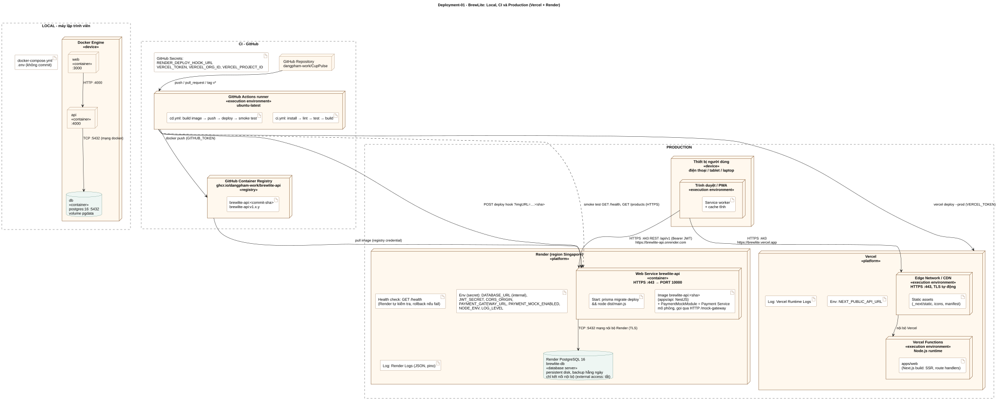

# BrewLite – Deployment view (Task 3.2)

Sơ đồ: [`diagrams/deployment.puml`](diagrams/deployment.puml) · [`diagrams/deployment.svg`](diagrams/deployment.svg) · Quyết định nền tảng: [ADR-009](adr/009-deployment-vercel-render.md)

Nền tảng thực tế nhóm dùng: **Vercel** cho Next.js, **Render** cho NestJS API và PostgreSQL, **GitHub** cho mã nguồn, CI/CD và container registry (GHCR).

## 1. Ranh giới môi trường

| Môi trường | Chạy ở đâu | Mục đích | Dữ liệu |
|---|---|---|---|
| **Local** | Docker Engine trên máy lập trình viên, `docker compose up` | Phát triển, chạy thử toàn bộ | DB container `postgres:16`, volume `pgdata`, seed mẫu |
| **CI** | GitHub Actions runner `ubuntu-latest` | Lint, test, build, đóng gói image, deploy, smoke test | DB service tạm `postgres:16` cho integration test, xóa sau mỗi lần chạy |
| **Production** | Vercel + Render (region Singapore) | Phục vụ người dùng và nghiệm thu | Render PostgreSQL, persistent disk, backup hằng ngày |

Không có kết nối từ Local hoặc CI vào DB production. CI chỉ tác động lên production qua **deploy hook** và **Vercel CLI**, đều xác thực bằng secret.

## 2. Truy vết node → kiến trúc → mã nguồn

Tiêu chí nghiệm thu Task 3: *mỗi container/dịch vụ trong deployment diagram truy vết được tới một thành phần trong mô tả kiến trúc và mã nguồn.*

| Node / artifact (Deployment-01) | Container C4-02 / thành phần C4-03 | Mã nguồn / cấu hình |
|---|---|---|
| Trình duyệt / PWA + Service worker | Web App (phía client) | `apps/web/src/app/sw.ts`, `apps/web/public/manifest.webmanifest` |
| Vercel Edge Network / CDN – static assets | Web App (tài nguyên tĩnh) | `apps/web/public/`, output `.next/static` |
| Vercel Functions – `apps/web` | Web App (SSR, route handlers) | `apps/web/` (`next build`), cấu hình `vercel.json` |
| Render Web Service `brewlite-api` | API | `apps/api/`, `apps/api/Dockerfile` |
| Artifact image `brewlite-api:<sha>` | API + PaymentMockModule | Build từ `apps/api/Dockerfile` trong `.github/workflows/cd.yml` |
| Start: `prisma migrate deploy && node dist/main.js` | PrismaModule, migration | `apps/api/prisma/migrations/`, `apps/api/docker-entrypoint.sh` |
| Self-call "Payment Service mô phỏng" | Payment Service (C4-02), PaymentMockModule (C4-03) | `apps/api/src/modules/payment-mock/` |
| Health check `GET /health` | HealthModule | `apps/api/src/modules/health/` |
| Render PostgreSQL `brewlite-db` | Database | `apps/api/prisma/schema.prisma` |
| GitHub Actions – `ci.yml` | (quy trình) | `.github/workflows/ci.yml` |
| GitHub Actions – `cd.yml` | (quy trình) | `.github/workflows/cd.yml` |
| GHCR `ghcr.io/dangpham-work/brewlite-api` | (registry của API) | Tag do `cd.yml` gán |
| Docker Engine local: web, api, db | Web App, API, Database | `docker-compose.yml`, `apps/web/Dockerfile`, `apps/api/Dockerfile`, `.env.example` |

## 3. Giao thức và cổng

| Từ → Tới | Giao thức / cổng | Ghi chú |
|---|---|---|
| Trình duyệt → Vercel | HTTPS 443 | TLS do Vercel cấp tự động; HTTP chuyển hướng HTTPS (NFR-07) |
| Trình duyệt → Render API | HTTPS 443 | `https://brewlite-api.onrender.com/api/v1`, CORS chỉ cho domain Vercel |
| Render edge → container API | HTTP nội bộ, `PORT=10000` | TLS kết thúc tại Render |
| API → Render PostgreSQL | TCP 5432, mạng nội bộ Render, TLS | Dùng *Internal Database URL*; **external access tắt** nên DB không có địa chỉ public |
| API → Payment Service mô phỏng | HTTP tới chính service (`PAYMENT_GATEWAY_URL`) | Timeout 10 giây, header `Idempotency-Key` |
| GitHub Actions → GHCR | HTTPS, `GITHUB_TOKEN` | `docker push` |
| Render → GHCR | HTTPS, registry credential (PAT chỉ quyền `read:packages`) | Kéo image theo tag SHA |
| GitHub Actions → Render | HTTPS, deploy hook URL (secret) | `POST …?imgURL=ghcr.io/…:<sha>` |
| GitHub Actions → Vercel | HTTPS, `VERCEL_TOKEN` | `vercel deploy --prebuilt --prod` |
| Local web → local api → local db | HTTP 3000 → 4000; TCP 5432 | Mạng Docker Compose |

## 4. Secret và biến môi trường

| Nơi lưu | Biến | Ai đọc |
|---|---|---|
| GitHub Secrets | `RENDER_DEPLOY_HOOK_URL`, `VERCEL_TOKEN`, `VERCEL_ORG_ID`, `VERCEL_PROJECT_ID` | Workflow `cd.yml` |
| Render Environment (secret) | `DATABASE_URL` (internal), `JWT_SECRET`, `CORS_ORIGIN`, `PAYMENT_GATEWAY_URL`, `PAYMENT_MOCK_ENABLED`, `NODE_ENV=production`, `LOG_LEVEL` | Container API |
| Vercel Environment | `NEXT_PUBLIC_API_URL` | Build Next.js |
| `.env` (local, **không commit**) | Như `.env.example` | Docker Compose |

Secret không nằm trong repo hay image. Log CI che secret (GitHub tự che giá trị của secret). Bước quét secret (gitleaks) chạy trong CI (NFR-06).

## 5. Health check, log và khôi phục

| Hạng mục | Thiết kế |
|---|---|
| Health check | Render gọi `GET /health`. Bản deploy mới không đạt thì Render giữ bản cũ đang chạy. Sau deploy, CI chạy smoke test `GET /health` và `GET /api/v1/products` (có retry vì cold start) |
| Log | API: log JSON (pino) → Render Logs. Web: Vercel Runtime Logs. Giữ theo thời hạn của gói miễn phí |
| Migration | Chạy `prisma migrate deploy` khi container khởi động; migration lỗi thì container không lên, health check fail, bản cũ tiếp tục phục vụ |
| Rollback API | Gọi lại deploy hook với `imgURL` của **SHA trước đó** (image vẫn còn trên GHCR), hoặc "Rollback" trong Render dashboard |
| Rollback Web | `vercel rollback` hoặc promote bản deploy trước trong Vercel dashboard |
| Backup DB | Render PostgreSQL backup hằng ngày (gói trả phí); gói free: `pg_dump` thủ công trước mỗi migration lớn |

Quy trình chi tiết sẽ nằm ở `docs/deployment.md` (Task 5).

## 6. Giới hạn của nền tảng và cách xử lý

| Giới hạn | Ảnh hưởng | Cách xử lý |
|---|---|---|
| Render free web service ngủ sau 15 phút | Lần gọi đầu chậm 30–60 giây | Smoke test có retry; "đánh thức" trước buổi chấm/demo (R8) |
| Render PostgreSQL free hết hạn sau 30 ngày | Mất DB nếu không nâng cấp (R1) | Trước khi hết hạn: nâng lên gói Basic (~6 USD/tháng) hoặc tạo DB mới + `migrate deploy` + seed; ghi ngày tạo DB trong `docs/deployment.md` |
| Vercel Hobby chỉ dùng phi thương mại | Phù hợp đồ án | — |
| GHCR package private cần credential | Render phải có registry credential | Tạo PAT `read:packages`, lưu trong Render |
