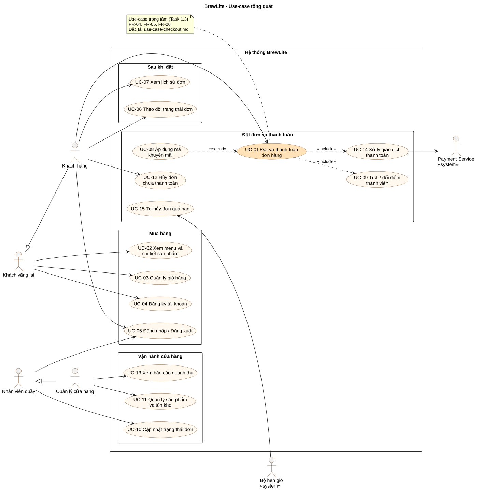

# BrewLite – Đặc tả Yêu cầu Phần mềm rút gọn (SRS) (Task 1.2)

| Thuộc tính | Giá trị |
|---|---|
| Tài liệu | `docs/requirements/srs.md` |
| Phiên bản | 1.0 |
| Ngày | 2026-11-01 |
| Trạng thái | Bản nháp – chờ nhóm duyệt |
| Tài liệu liên quan | [Bối cảnh & phạm vi](context-and-scope.md) · [Đặc tả UC-01](use-case-checkout.md) · [Use-case tổng quát](../diagrams/usecase-overview.svg) |

## Mục lục

1. [Giới thiệu](#1-giới-thiệu)
2. [Tác nhân và vai trò](#2-tác-nhân-và-vai-trò)
3. [Quy tắc nghiệp vụ](#3-quy-tắc-nghiệp-vụ)
4. [Yêu cầu chức năng (FR)](#4-yêu-cầu-chức-năng-fr)
5. [Yêu cầu phi chức năng (NFR)](#5-yêu-cầu-phi-chức-năng-nfr)
6. [Sơ đồ use-case tổng quát](#6-sơ-đồ-use-case-tổng-quát)
7. [User story](#7-user-story)
8. [Giao diện ngoài](#8-giao-diện-ngoài)
9. [Tổng hợp ưu tiên và phân bổ Sprint](#9-tổng-hợp-ưu-tiên-và-phân-bổ-sprint)

---

## 1. Giới thiệu

### 1.1 Mục đích

Tài liệu này mô tả **hệ thống BrewLite làm gì và không làm gì**. Mỗi yêu cầu có:

- mã định danh duy nhất: `FR-xx` cho chức năng, `NFR-xx` cho phi chức năng;
- mức ưu tiên MoSCoW;
- **tiêu chí chấp nhận (AC)** kiểm chứng được, đánh mã `AC-xx.y`. Các task sau viết test trực tiếp từ những AC này, và test tham chiếu lại mã AC.

### 1.2 Quy ước MoSCoW

| Mức | Ý nghĩa trong dự án |
|---|---|
| **Must** | Bắt buộc cho MVP. Thiếu thì luồng *Xem menu → … → Theo dõi đơn* không chạy hoặc không đạt yêu cầu đề bài. |
| **Should** | Quan trọng, làm trong Sprint 2 sau khi các Must đã chạy end-to-end. |
| **Could** | Làm nếu còn thời gian. Không ảnh hưởng nghiệm thu. |
| **Won't** | Đã thống nhất **không** làm trong phiên bản này. Ghi lại để tránh phình phạm vi. |

### 1.3 Quy ước chung

- Tiền tệ VND, số nguyên, hiển thị dạng `45.000 ₫`.
- Mọi API có tiền tố `/api/v1`. Trong tài liệu viết rút gọn, ví dụ `GET /products`.
- Lỗi API trả về JSON thống nhất:
  ```json
  { "statusCode": 409, "code": "OUT_OF_STOCK", "message": "Một số món đã hết hàng", "details": { "productIds": ["…"] } }
  ```
- Thời gian lưu UTC trong database, hiển thị theo múi giờ `Asia/Ho_Chi_Minh`.

---

## 2. Tác nhân và vai trò

| Tác nhân | Vai trò hệ thống | Mô tả | Stakeholder |
|---|---|---|---|
| Khách vãng lai (Guest) | — | Chưa đăng nhập. Được xem menu, chi tiết sản phẩm và giỏ hàng. | SH-01 |
| Khách hàng (Customer) | `CUSTOMER` | Đã đăng nhập. Kế thừa quyền của Guest, được đặt đơn, thanh toán, xem đơn của mình và tích điểm. | SH-01 |
| Nhân viên quầy (Staff) | `STAFF` | Xem đơn đã thanh toán và cập nhật trạng thái chế biến. | SH-02 |
| Quản lý cửa hàng (Manager) | `MANAGER` | Kế thừa quyền Staff, được quản lý sản phẩm, tồn kho, khuyến mãi và xem báo cáo. | SH-03 |
| Payment Service | Hệ thống ngoài | Dịch vụ thanh toán mô phỏng, xử lý giao dịch Ví/Thẻ. | SH-06 |
| Bộ hẹn giờ (Scheduler) | Hệ thống nội bộ | Tác vụ định kỳ hủy đơn quá hạn thanh toán. | — |

---

## 3. Quy tắc nghiệp vụ

Các quy tắc dưới đây được tham chiếu trong tiêu chí chấp nhận.

| Mã | Quy tắc |
|---|---|
| BR-01 | Mỗi sản phẩm có **giá cơ bản** (`basePrice`), danh sách **size** kèm phụ thu (mặc định S +0, M +5.000, L +10.000; cấu hình được theo sản phẩm) và danh sách **topping** kèm giá. |
| BR-02 | **Thành tiền một dòng** = (`basePrice` + phụ thu size + Σ giá topping) × số lượng. |
| BR-03 | Mỗi dòng phải chọn **đúng 1 size** và **0–3 topping** khác nhau. Số lượng mỗi dòng là **1–10**. Một đơn có **tối đa 20 ly**. Ghi chú mỗi dòng **≤ 100 ký tự**. |
| BR-04 | **Tạm tính** = Σ thành tiền các dòng. **Giảm giá** = khuyến mãi (BR-13) + đổi điểm (BR-15). **Tổng** = Tạm tính − Giảm giá, và luôn ≥ 0. |
| BR-05 | Server **luôn tự tính lại giá** từ database và bỏ qua giá client gửi lên. Nếu tổng server tính khác `expectedTotal` client gửi kèm thì trả **409 `PRICE_CHANGED`** kèm giá mới. |
| BR-06 | Khi tạo đơn, **tên và đơn giá** của sản phẩm, size, topping được **chụp lại (snapshot)** vào `OrderItem`. Sửa menu về sau không làm đổi đơn cũ. |
| BR-07 | Tồn kho được **kiểm tra và trừ trong cùng một transaction** với việc tạo đơn. Chỉ cần một món không đủ là cả đơn bị từ chối (**409 `OUT_OF_STOCK`**) và không món nào bị trừ kho. Tồn kho không bao giờ âm. |
| BR-08 | Đơn ở trạng thái `PENDING_PAYMENT` quá **15 phút** (`expiresAt`) sẽ bị hủy tự động và **hoàn lại tồn kho**. |
| BR-09 | Mỗi đơn được thanh toán thất bại **tối đa 3 lần**. Lần thất bại thứ 3 làm đơn chuyển `CANCELLED` và hoàn lại tồn kho. |
| BR-10 | Mỗi đơn có **tối đa 1 payment `SUCCEEDED`**. Số tiền thanh toán luôn bằng `Order.total`. |
| BR-11 | Mỗi yêu cầu thanh toán phải kèm header **`Idempotency-Key`** (UUID v4) do client sinh, có hiệu lực **24 giờ** trong phạm vi một người dùng. Gửi lại cùng khóa và cùng nội dung thì nhận **đúng kết quả cũ**, Payment Service **không bị gọi lần hai**. Cùng khóa nhưng khác nội dung thì nhận **422 `IDEMPOTENCY_KEY_REUSED`**. |
| BR-12 | Luồng trạng thái đơn hợp lệ: `PENDING_PAYMENT → PAID` (thanh toán thành công); `PENDING_PAYMENT → CANCELLED` (khách hủy, quá hạn, hoặc thất bại lần 3); `PAID → PREPARING → READY → COMPLETED` (nhân viên). Mọi chuyển trạng thái khác bị từ chối. **Không hủy được đơn đã `PAID`** (không có hoàn tiền). |
| BR-13 | Mã khuyến mãi hợp lệ khi đang bật, nằm trong thời hạn, `usedCount < usageLimit` và Tạm tính ≥ `minOrderValue`. Loại `PERCENT` có trần `maxDiscount`; loại `FIXED` không vượt Tạm tính. Mỗi đơn **tối đa 1 mã**. `usedCount` chỉ tăng khi đơn chuyển `PAID`. |
| BR-14 | **Tích điểm:** khi đơn chuyển `PAID`, khách được `floor(Tổng / 10.000)` điểm. Mỗi đơn chỉ được cộng điểm **một lần**. |
| BR-15 | **Đổi điểm** (Could): 1 điểm = 1.000 ₫, tối đa 50% Tạm tính sau khuyến mãi. Điểm bị trừ khi đơn `PAID` và được giữ nguyên nếu đơn bị hủy. |
| BR-16 | Mã đơn có dạng `BL-YYMMDD-NNNN`. `NNNN` tăng dần trong ngày và đồng thời là **số gọi món** hiển thị ở quầy. |
| BR-17 | Khách hàng chỉ xem và thao tác được trên **đơn của chính mình**. Truy cập đơn người khác trả **404** (không tiết lộ đơn đó có tồn tại). |
| BR-18 | **Không lưu số thẻ đầy đủ và CVV.** Số thẻ chỉ được chuyển tiếp tới Payment Service. Database chỉ lưu `cardLast4` và `cardBrand`. |

### 3.1 Dữ liệu test của Payment Service mô phỏng

| Phương thức | Dữ liệu test | Kết quả | Mã lỗi |
|---|---|---|---|
| Thẻ | `4242 4242 4242 4242` | Thành công | — |
| Thẻ | `4000 0000 0000 0002` | Thất bại | `CARD_DECLINED` |
| Thẻ | `4000 0000 0000 9995` | Thất bại | `INSUFFICIENT_FUNDS` |
| Thẻ | `4000 0000 0000 0119` | Lần đầu phản hồi chậm hơn 10 giây (API coi là **timeout**). Gọi lại cùng idempotency key thì thành công. | `PAYMENT_TIMEOUT` (tạm thời) |
| Thẻ | Số thẻ hợp lệ Luhn khác | Thành công | — |
| Ví | SĐT `0900000001` | Thất bại | `INSUFFICIENT_FUNDS` |
| Ví | SĐT `0900000002` | Thất bại | `WALLET_LOCKED` |
| Ví | SĐT di động Việt Nam hợp lệ khác | Thành công | — |

---

## 4. Yêu cầu chức năng (FR)

### 4.1 Bảng tổng hợp

| Mã | Nhóm | Tên yêu cầu | Ưu tiên | Sprint | Use-case |
|---|---|---|---|---|---|
| FR-01 | Menu | Xem menu | Must | 1 | UC-02 |
| FR-02 | Chi tiết sản phẩm | Xem chi tiết, chọn size và topping | Must | 1 (API) / 2 (tùy chọn) | UC-02 |
| FR-03 | Giỏ hàng | Quản lý giỏ hàng và tính tổng tiền | Must | 2 | UC-03 |
| FR-04 | Đặt đơn | Tạo đơn, kiểm tra và trừ tồn kho | Must | 2 | UC-01 |
| FR-05 | Thanh toán | Thanh toán Ví/Thẻ mô phỏng | Must | 2 | UC-01, UC-14 |
| FR-06 | Thanh toán | Idempotency khi gửi lại yêu cầu thanh toán | Must | 2 | UC-01 |
| FR-07 | Trạng thái đơn | Xác nhận và theo dõi trạng thái đơn | Must | 2 | UC-06 |
| FR-08 | Lịch sử đơn | Xem lịch sử đơn | Must | 2 | UC-07 |
| FR-09 | Xác thực | Đăng ký tài khoản khách hàng | Must | 2 | UC-04 |
| FR-10 | Xác thực | Đăng nhập, đăng xuất bằng JWT | Must | 2 | UC-05 |
| FR-11 | Xác thực | Phân quyền theo vai trò | Must | 2 | Tất cả |
| FR-12 | Quản lý trạng thái đơn | Nhân viên cập nhật trạng thái đơn | Must | 2 | UC-10 |
| FR-13 | Đặt đơn | Hủy đơn chưa thanh toán và tự hủy đơn quá hạn | Should | 2 | UC-12, UC-15 |
| FR-14 | Khuyến mãi | Áp dụng mã khuyến mãi | Should | 2 | UC-08 |
| FR-15 | Loyalty | Tích điểm thành viên | Should | 2 | UC-09 |
| FR-16 | Quản trị | Quản lý sản phẩm và tồn kho | Should | 2 | UC-11 |
| FR-17 | Menu | Tìm kiếm và lọc menu | Should | 2 | UC-02 |
| FR-18 | Loyalty | Đổi điểm lấy giảm giá | Could | — | UC-09 |
| FR-19 | Quản trị | Báo cáo doanh thu theo ngày | Could | — | UC-13 |
| FR-20 | Thông báo | Thông báo đẩy khi đơn sẵn sàng | Could | — | UC-06 |
| FR-21 | Thanh toán | Tích hợp cổng thanh toán thật | Won't | — | — |
| FR-22 | Đặt đơn | Giao hàng tận nơi | Won't | — | — |
| FR-23 | Quản trị | Quản lý nhiều chi nhánh | Won't | — | — |
| FR-24 | Xác thực | Đăng nhập bằng mạng xã hội | Won't | — | — |

### 4.2 Chi tiết và tiêu chí chấp nhận

#### FR-01 – Xem menu · **Must**

Mọi người dùng, kể cả chưa đăng nhập, xem được danh sách sản phẩm đang bán, nhóm theo danh mục.

| AC | Tiêu chí chấp nhận |
|---|---|
| AC-01.1 | `GET /products` trả **200**, **không cần token**, với mảng sản phẩm `isActive = true`. Mỗi phần tử có `id`, `name`, `imageUrl`, `basePrice`, `category`, `inStock` (= `stock > 0`). |
| AC-01.2 | Không trả sản phẩm `isActive = false`. |
| AC-01.3 | Màn hình menu hiện **skeleton** khi đang tải; hiện **"Chưa có món nào"** khi danh sách rỗng; hiện **thông báo lỗi và nút "Thử lại"** khi API lỗi hoặc mất mạng. Bấm "Thử lại" thì gọi lại API. |
| AC-01.4 | Sản phẩm có `inStock = false` hiện nhãn **"Hết hàng"** và không có nút thêm vào giỏ. |
| AC-01.5 | Ở chiều rộng **360 px** trang không cuộn ngang và mỗi sản phẩm hiện đủ ảnh, tên, giá. |

#### FR-02 – Xem chi tiết sản phẩm, chọn size và topping · **Must**

| AC | Tiêu chí chấp nhận |
|---|---|
| AC-02.1 | `GET /products/:id` trả **200** với đủ thông tin của FR-01, thêm `description`, `sizes[] {code, name, extraPrice}`, `toppings[] {id, name, price}`. |
| AC-02.2 | `id` không tồn tại hoặc sản phẩm `isActive = false` thì trả **404 `PRODUCT_NOT_FOUND`**. `id` sai định dạng UUID thì trả **400**. |
| AC-02.3 | Màn chi tiết **chọn sẵn size đầu tiên**. Không bỏ chọn được size, chỉ chọn được đúng 1 size (BR-03). |
| AC-02.4 | Chọn được **0–3 topping**. Khi đã chọn 3, các topping còn lại bị vô hiệu hóa. |
| AC-02.5 | Giá hiển thị cập nhật **ngay khi đổi size, topping hoặc số lượng** và đúng công thức BR-02. Ví dụ: basePrice 35.000, size L (+10.000), topping trân châu 5.000, số lượng 2 → **100.000 ₫**. |
| AC-02.6 | Số lượng chỉ trong khoảng 1–10. Ghi chú quá 100 ký tự thì hiện lỗi và nút "Thêm vào giỏ" bị vô hiệu hóa. |

#### FR-03 – Quản lý giỏ hàng và tính tổng tiền · **Must**

| AC | Tiêu chí chấp nhận |
|---|---|
| AC-03.1 | Bấm "Thêm vào giỏ" thì giỏ tăng đúng số lượng và biểu tượng giỏ cập nhật số ly. |
| AC-03.2 | Thêm cùng sản phẩm, cùng size, cùng bộ topping và cùng ghi chú thì **gộp vào một dòng** (cộng số lượng). Khác bất kỳ yếu tố nào thì tạo dòng mới. |
| AC-03.3 | Sửa được số lượng (1–10) và xóa được từng dòng. Thành tiền dòng và Tạm tính cập nhật đúng BR-02 và BR-04. |
| AC-03.4 | Giỏ hàng **giữ nguyên sau khi tải lại trang** và sau khi đăng nhập (lưu ở thiết bị). |
| AC-03.5 | Khách vãng lai dùng được giỏ hàng. |
| AC-03.6 | Giỏ rỗng thì hiện "Giỏ hàng trống" và nút "Đặt hàng" bị vô hiệu hóa. |
| AC-03.7 | Nếu thao tác làm tổng số ly vượt 20 (BR-03) thì không thêm được và hiện thông báo. |

#### FR-04 – Tạo đơn, kiểm tra và trừ tồn kho · **Must**

| AC | Tiêu chí chấp nhận |
|---|---|
| AC-04.1 | `POST /orders` **không có JWT hợp lệ** thì trả **401**. Giao diện chuyển sang màn đăng nhập, **giữ nguyên giỏ** và quay lại trang thanh toán sau khi đăng nhập. |
| AC-04.2 | Body sai định dạng (thiếu `items`, số lượng ngoài khoảng, quá 3 topping, size không thuộc sản phẩm…) thì trả **400** kèm danh sách lỗi theo từng trường. Không có đơn nào được tạo. |
| AC-04.3 | Server tự tính lại giá (BR-05). Lệch `expectedTotal` thì trả **409 `PRICE_CHANGED`** kèm giá mới. |
| AC-04.4 | Thành công thì trả **201** với `id`, `code` (BR-16), `status = PENDING_PAYMENT`, `subtotal`, `discount`, `total`, `expiresAt` (= thời điểm tạo + 15 phút). Tồn kho mỗi sản phẩm **giảm đúng bằng** số lượng đặt. |
| AC-04.5 | Có một món không đủ tồn kho thì trả **409 `OUT_OF_STOCK`** với `details.productIds`. **Tồn kho mọi sản phẩm giữ nguyên** và không có đơn nào được tạo. |
| AC-04.6 | Đặt món đã ngừng bán (`isActive = false`) thì trả **409 `PRODUCT_UNAVAILABLE`**. |
| AC-04.7 | Đơn lưu snapshot tên và đơn giá (BR-06). Sửa giá sản phẩm sau khi đặt không làm đổi `total` của đơn. |
| AC-04.8 | Tạo đơn thành công thì giỏ hàng trên thiết bị được xóa và giao diện chuyển sang bước thanh toán. |

#### FR-05 – Thanh toán Ví/Thẻ mô phỏng · **Must**

| AC | Tiêu chí chấp nhận |
|---|---|
| AC-05.1 | `POST /payments` với body `{ orderId, method: "CARD" \| "WALLET", card?: {number, expMonth, expYear, cvv}, wallet?: {phone} }` yêu cầu JWT. Chỉ **chủ đơn** gọi được, người khác nhận **404** (BR-17). |
| AC-05.2 | Frontend và backend **cùng kiểm tra**: số thẻ đúng Luhn, 16 chữ số; ngày hết hạn chưa qua; CVV 3 chữ số; SĐT ví là số di động Việt Nam 10 chữ số. Sai thì trả **400** và không gọi Payment Service. |
| AC-05.3 | Đơn không ở `PENDING_PAYMENT` hoặc đã quá `expiresAt` thì trả **409 `ORDER_NOT_PAYABLE`**. |
| AC-05.4 | **Thành công** (thẻ `4242…`): trả **201** `{ paymentId, status: "SUCCEEDED", orderStatus: "PAID" }`. `Payment.amount = Order.total`. Đơn chuyển `PAID`. |
| AC-05.5 | **Thất bại** (thẻ `4000…0002`): trả **402 `PAYMENT_FAILED`** với `details.reason = "CARD_DECLINED"`. Payment lưu `FAILED`, đơn **vẫn `PENDING_PAYMENT`**. Giao diện hiện lý do bằng tiếng Việt và cho thử lại hoặc đổi phương thức. |
| AC-05.6 | Thất bại lần thứ 3 thì đơn chuyển `CANCELLED` và tồn kho được hoàn lại (BR-09). |
| AC-05.7 | Payment Service **không phản hồi trong 10 giây** thì trả **202** `{ status: "PENDING" }`. Giao diện hiện "Đang xử lý" và tự gửi lại **cùng `Idempotency-Key`** để lấy kết quả cuối. |
| AC-05.8 | Bảng `payments` **không có** số thẻ đầy đủ hay CVV, chỉ có `cardLast4` và `cardBrand` (BR-18). Log ứng dụng cũng không chứa các giá trị này. |

#### FR-06 – Idempotency khi gửi lại yêu cầu thanh toán · **Must**

| AC | Tiêu chí chấp nhận |
|---|---|
| AC-06.1 | `POST /payments` **thiếu header `Idempotency-Key`** hoặc giá trị không phải UUID thì trả **400**. |
| AC-06.2 | Gửi lại **cùng khóa, cùng body** trong 24 giờ thì nhận **cùng mã HTTP và cùng body** như lần đầu. Payment Service được gọi **đúng 1 lần** (kiểm bằng bộ đếm cuộc gọi của mock). |
| AC-06.3 | Cùng khóa nhưng **khác body** thì trả **422 `IDEMPOTENCY_KEY_REUSED`**. |
| AC-06.4 | Hai request **đồng thời** cùng khóa thì chỉ một request được xử lý. Request còn lại nhận cùng kết quả hoặc **409 `REQUEST_IN_PROGRESS`**. |
| AC-06.5 | Đơn **đã `PAID`** mà nhận yêu cầu thanh toán với **khóa mới** thì trả **409 `ORDER_ALREADY_PAID`**. Không bao giờ có 2 payment `SUCCEEDED` cho một đơn (BR-10). |

#### FR-07 – Xác nhận và theo dõi trạng thái đơn · **Must**

| AC | Tiêu chí chấp nhận |
|---|---|
| AC-07.1 | Thanh toán thành công thì chuyển tới màn **xác nhận** `/orders/:id`, hiện mã đơn, số gọi món, danh sách món, tổng tiền, phương thức (thẻ hiện `•••• 4242`) và trạng thái. |
| AC-07.2 | `GET /orders/:id` chỉ trả cho chủ đơn, Staff hoặc Manager. Người khác nhận **404**. |
| AC-07.3 | Khi nhân viên đổi trạng thái, màn hình của khách hiện trạng thái mới trong **≤ 5 giây** mà không cần tải lại trang. |
| AC-07.4 | Có **dòng thời gian** các trạng thái đã qua kèm giờ, phút. |

#### FR-08 – Xem lịch sử đơn · **Must**

| AC | Tiêu chí chấp nhận |
|---|---|
| AC-08.1 | `GET /orders?page=1&limit=10` yêu cầu JWT và chỉ trả **đơn của người gọi**, mới nhất trước, mặc định 10 đơn mỗi trang, kèm `total` và `page`. |
| AC-08.2 | Mỗi dòng hiện mã đơn, ngày giờ, số ly, tổng tiền và trạng thái. Bấm vào thì mở chi tiết (FR-07). |
| AC-08.3 | Chưa có đơn thì hiện "Bạn chưa có đơn nào" và nút "Xem menu". |

#### FR-09 – Đăng ký tài khoản khách hàng · **Must**

| AC | Tiêu chí chấp nhận |
|---|---|
| AC-09.1 | `POST /auth/register` với `email`, `password`, `fullName`, `phone?` trả **201**. Tài khoản mới có vai trò `CUSTOMER` và 0 điểm. |
| AC-09.2 | Kiểm tra ở cả frontend và backend: email hợp lệ; mật khẩu **≥ 8 ký tự, có chữ và số**; họ tên 2–50 ký tự; SĐT (nếu có) là số di động Việt Nam 10 chữ số. Sai thì trả **400** kèm lỗi từng trường. |
| AC-09.3 | Email đã tồn tại (không phân biệt hoa thường) thì trả **409 `EMAIL_TAKEN`**. |
| AC-09.4 | Mật khẩu lưu dạng **hash bcrypt**. Không response nào chứa `password` hay `passwordHash`. |

#### FR-10 – Đăng nhập, đăng xuất bằng JWT · **Must**

| AC | Tiêu chí chấp nhận |
|---|---|
| AC-10.1 | `POST /auth/login` đúng thông tin thì trả **200** `{ accessToken, expiresIn: 3600, user: {id, email, fullName, role} }`. |
| AC-10.2 | Sai email **hoặc** sai mật khẩu đều trả **401 `INVALID_CREDENTIALS`** với cùng một thông báo (không tiết lộ email có tồn tại hay không). |
| AC-10.3 | Endpoint cần đăng nhập trả **401** khi token thiếu, sai chữ ký hoặc hết hạn (60 phút). |
| AC-10.4 | Đăng xuất thì xóa token phía client và chuyển về menu. Các request sau đó không còn gửi token. |
| AC-10.5 | Token hết hạn giữa chừng thì giao diện chuyển tới đăng nhập kèm `returnUrl` và **không mất giỏ hàng**. |

#### FR-11 – Phân quyền theo vai trò · **Must**

| AC | Tiêu chí chấp nhận |
|---|---|
| AC-11.1 | Có 3 vai trò `CUSTOMER`, `STAFF`, `MANAGER`, nằm trong claim `role` của JWT và **được kiểm tra ở server**. |
| AC-11.2 | `CUSTOMER` gọi endpoint `/staff/*` hoặc `/manager/*` thì nhận **403**. `STAFF` gọi `/manager/*` thì nhận **403**. |
| AC-11.3 | `MANAGER` gọi được mọi endpoint của `STAFF`. |
| AC-11.4 | Giao diện ẩn các menu không thuộc vai trò hiện tại. Tuy vậy, truy cập thẳng URL vẫn bị server chặn. |

#### FR-12 – Nhân viên cập nhật trạng thái đơn · **Must**

| AC | Tiêu chí chấp nhận |
|---|---|
| AC-12.1 | `GET /staff/orders?status=PAID,PREPARING,READY` trả các đơn theo trạng thái, **cũ nhất trước**. Không trả đơn `PENDING_PAYMENT`. |
| AC-12.2 | Màn hình nhân viên hiện đơn theo 3 cột *Đã thanh toán – Đang pha – Sẵn sàng*, mỗi đơn có số gọi món, món, size, topping và ghi chú. Đơn mới xuất hiện trong **≤ 5 giây**. |
| AC-12.3 | `PATCH /staff/orders/:id/status { status }` chỉ chấp nhận chuyển trạng thái đúng BR-12. Sai luồng (ví dụ `PAID → READY`) thì trả **409 `INVALID_TRANSITION`**. |
| AC-12.4 | Mỗi lần chuyển trạng thái đều ghi lịch sử gồm trạng thái cũ, trạng thái mới, người thực hiện và thời điểm. |

#### FR-13 – Hủy đơn chưa thanh toán và tự hủy đơn quá hạn · **Should**

| AC | Tiêu chí chấp nhận |
|---|---|
| AC-13.1 | `POST /orders/:id/cancel` của chủ đơn khi đơn đang `PENDING_PAYMENT` thì đơn chuyển `CANCELLED` và **tồn kho được hoàn lại trong cùng transaction**. |
| AC-13.2 | Hủy đơn ở trạng thái khác `PENDING_PAYMENT` thì trả **409 `ORDER_NOT_CANCELLABLE`**. |
| AC-13.3 | Tác vụ định kỳ chạy **mỗi phút**, hủy đơn `PENDING_PAYMENT` đã quá `expiresAt` và hoàn lại tồn kho. Đơn quá hạn không quá 1 phút sau `expiresAt` là đã bị hủy. |

#### FR-14 – Áp dụng mã khuyến mãi · **Should**

| AC | Tiêu chí chấp nhận |
|---|---|
| AC-14.1 | `POST /promotions/validate { code, subtotal }` trả `{ valid: true, discount }` hoặc `{ valid: false, reason }`. `reason` là một trong `PROMO_NOT_FOUND`, `PROMO_EXPIRED`, `PROMO_MIN_ORDER`, `PROMO_USAGE_LIMIT`. |
| AC-14.2 | `POST /orders` kèm `promoCode` thì server áp giảm giá đúng BR-13. Mã không hợp lệ thì trả **422** kèm `reason`. |
| AC-14.3 | Ví dụ kiểm thử: mã `GIAM10` (10%, trần 20.000) với Tạm tính 300.000 thì giảm **20.000**; với Tạm tính 150.000 thì giảm **15.000**. |
| AC-14.4 | `usedCount` chỉ tăng khi đơn chuyển `PAID`. Đơn bị hủy không làm tốn lượt dùng. |

#### FR-15 – Tích điểm thành viên · **Should**

| AC | Tiêu chí chấp nhận |
|---|---|
| AC-15.1 | Khi đơn chuyển `PAID`, tạo một `LoyaltyTransaction` loại `EARN` với `points = floor(total / 10.000)` và cộng vào điểm của khách, **trong cùng transaction** với việc cập nhật đơn. |
| AC-15.2 | Mỗi đơn chỉ có tối đa 1 giao dịch `EARN` (ràng buộc unique theo `orderId` và `type`). Gửi lại yêu cầu thanh toán không cộng điểm lần hai. |
| AC-15.3 | `GET /me/loyalty` trả số điểm hiện có và lịch sử giao dịch điểm, mới nhất trước. |

#### FR-16 – Quản lý sản phẩm và tồn kho · **Should**

| AC | Tiêu chí chấp nhận |
|---|---|
| AC-16.1 | `MANAGER` tạo và sửa được sản phẩm: tên, mô tả, danh mục, `basePrice`, size, topping, `imageUrl`, `stock`, `isActive`. |
| AC-16.2 | `stock` và giá là số nguyên ≥ 0. Giá trị âm thì trả **400**. |
| AC-16.3 | "Xóa" sản phẩm là đặt `isActive = false` (xóa mềm) để không ảnh hưởng đơn cũ. |
| AC-16.4 | Thay đổi được phản ánh trong `GET /products` ngay ở lần gọi kế tiếp. |

#### FR-17 – Tìm kiếm và lọc menu · **Should**

| AC | Tiêu chí chấp nhận |
|---|---|
| AC-17.1 | `GET /products?category=<slug>` chỉ trả sản phẩm thuộc danh mục đó. |
| AC-17.2 | `GET /products?q=ca phe` tìm được "Cà phê sữa": **không phân biệt hoa thường và dấu**. |
| AC-17.3 | Giao diện có thanh tab danh mục và ô tìm kiếm. Tìm không ra thì hiện "Không tìm thấy món phù hợp". |

#### FR-18 – Đổi điểm lấy giảm giá · **Could**

| AC | Tiêu chí chấp nhận |
|---|---|
| AC-18.1 | Ở bước thanh toán, khách chọn số điểm muốn dùng. Giảm giá tính theo BR-15 và không vượt số điểm đang có. |
| AC-18.2 | Khi đơn `PAID` thì tạo `LoyaltyTransaction` loại `REDEEM` với số điểm âm. |

#### FR-19 – Báo cáo doanh thu theo ngày · **Could**

| AC | Tiêu chí chấp nhận |
|---|---|
| AC-19.1 | `GET /manager/reports/daily?from=&to=` trả cho mỗi ngày: số đơn đã thanh toán, doanh thu và 5 món bán chạy. Đơn `CANCELLED` không được tính. |

#### FR-20 – Thông báo đẩy khi đơn sẵn sàng · **Could**

| AC | Tiêu chí chấp nhận |
|---|---|
| AC-20.1 | Khách đã cho phép thông báo thì nhận Web Push trong **≤ 10 giây** sau khi đơn chuyển `READY`. |

#### FR-21 → FR-24 – Không thực hiện · **Won't**

| Mã | Nội dung | Tiêu chí chấp nhận |
|---|---|---|
| FR-21 | Cổng thanh toán thật (VNPay, MoMo, Stripe…) | Không có tích hợp hay khóa API của cổng thật trong mã nguồn. Mọi thanh toán đi qua Payment Service mô phỏng. |
| FR-22 | Giao hàng tận nơi | Không có trường địa chỉ giao hàng hay phí ship. |
| FR-23 | Nhiều chi nhánh | Dữ liệu không có thực thể chi nhánh. |
| FR-24 | Đăng nhập mạng xã hội | Màn đăng nhập chỉ có email và mật khẩu. |

---

## 5. Yêu cầu phi chức năng (NFR)

| Mã | Nhóm | Yêu cầu | Ưu tiên | Tiêu chí chấp nhận (đo được) | Cách kiểm chứng |
|---|---|---|---|---|---|
| NFR-01 | Hiệu năng | Thời gian phản hồi API | Must | Với 20 người dùng đồng thời (không tính cold start): `GET /products` có p95 ≤ **500 ms**; `POST /orders` và `POST /payments` có p95 ≤ **1.000 ms** (không tính thời gian chờ Payment Service). | Script k6 trên production |
| NFR-02 | Hiệu năng | Tốc độ tải trang | Should | Trang menu trên mobile (Lighthouse, giả lập 4G): Performance ≥ **80**, LCP ≤ **2,5 s**, CLS ≤ **0,1**. | Lighthouse CI / báo cáo Lighthouse |
| NFR-03 | Bảo mật | Bảo vệ mật khẩu | Must | Mật khẩu hash bằng **bcrypt cost ≥ 10**. Không API hay log nào trả về hoặc ghi ra mật khẩu, hash. | Unit test + kiểm tra log |
| NFR-04 | Bảo mật | Xác thực JWT | Must | JWT ký **HS256** với secret ≥ 32 byte lấy từ biến môi trường. Hết hạn sau **60 phút**. Token sai hoặc hết hạn bị từ chối (AC-10.3). | Integration test |
| NFR-05 | Bảo mật | Validate dữ liệu | Must | **Mọi** body và query đều được validate ở backend theo whitelist; trường lạ bị từ chối. Dữ liệu sai trả **400**, không bao giờ trả 500. Frontend validate cùng quy tắc trước khi gửi. | Integration test với dữ liệu sai |
| NFR-06 | Bảo mật | Quản lý secret | Must | Không có secret trong repo hay lịch sử git; chỉ có `.env.example`. Secret production nằm trong GitHub Secrets hoặc biến môi trường của nền tảng. Bước quét secret trong CI **không phát hiện lỗi**. Log CI không in secret. | Quét secret (gitleaks) trong CI |
| NFR-07 | Bảo mật | Mã hóa đường truyền | Must | Frontend và API production **chỉ chạy HTTPS**; truy cập HTTP được chuyển hướng sang HTTPS. Database production **không có địa chỉ public** (hoặc chỉ cho phép kết nối TLS từ API). | Kiểm tra URL, cấu hình nền tảng |
| NFR-08 | Bảo mật | Chống dò mật khẩu và lạm dụng | Should | `POST /auth/login` giới hạn **5 lần/phút/IP**, quá thì trả **429**. Mọi API giới hạn chung **100 request/phút/IP**. Có header bảo mật (Helmet). CORS chỉ cho domain frontend. | Integration test |
| NFR-09 | Khả dụng | Mobile-first | Must | Mọi màn hình dùng tốt ở chiều rộng **360–430 px** không cuộn ngang. Vùng chạm ≥ **44×44 px**. Từ menu tới thanh toán xong một ly ≤ **8 lần chạm**. | Playwright viewport mobile + kiểm thử thủ công |
| NFR-10 | Khả dụng | Truy cập (accessibility) | Should | Lighthouse Accessibility ≥ **90**. Mọi ô nhập có nhãn. Độ tương phản chữ ≥ **4,5:1**. Dùng được bằng bàn phím. | Lighthouse, axe |
| NFR-11 | Khả dụng | PWA | Must | Có `manifest` (tên, icon 192/512, `display: standalone`) và service worker. Trình duyệt cho phép **"Cài đặt ứng dụng"**. Khi mất mạng có trang offline thông báo thay vì trang lỗi của trình duyệt. | Lighthouse PWA / DevTools Application |
| NFR-12 | Khả dụng | Ngôn ngữ, định dạng | Must | Giao diện tiếng Việt. Tiền dạng `45.000 ₫`. Thời gian theo `Asia/Ho_Chi_Minh`. Thông báo lỗi dễ hiểu, không lộ thông tin kỹ thuật. | Kiểm thử thủ công + E2E |
| NFR-13 | Tin cậy | Toàn vẹn dữ liệu đơn và kho | Must | Tạo đơn + trừ kho, thanh toán + cập nhật đơn + cộng điểm đều chạy **trong transaction**. Test **10 request đồng thời** đặt cùng sản phẩm còn 5 ly (mỗi request 1 ly) cho kết quả: **đúng 5 thành công, 5 nhận `OUT_OF_STOCK`, tồn kho cuối = 0**. | Integration test đồng thời |
| NFR-14 | Tin cậy | Health check, sẵn sàng | Must | `GET /health` trả **200** `{status:"ok", db:"up"}` trong ≤ **1 s** khi DB hoạt động; trả **503** khi mất kết nối DB. Production hoạt động trong suốt tuần chấm (uptime ≥ **99%**). | Smoke test, cron ping |
| NFR-15 | Triển khai | Chạy local bằng Docker | Must | Người ngoài nhóm clone repo, chạy `docker compose up` và có web, API, DB hoạt động trong ≤ **10 phút** theo README. Migration và seed **tái tạo được** database từ đầu. | Thử trên máy sạch |
| NFR-16 | Triển khai | CI | Must | Mỗi pull request tự chạy **Install → Lint → Unit Test → Build** trong ≤ **10 phút**. **PR không merge được** nếu một bước thất bại (branch protection). | Lịch sử GitHub Actions |
| NFR-17 | Triển khai | CD và rollback | Must | Push lên `main` hoặc tag `v*` thì chạy lint/test → build → Docker image **tag theo commit SHA** (và semver khi có tag) → push registry → migrate → deploy → **smoke test**. Smoke test fail thì pipeline dừng và có hướng dẫn **rollback về image trước đó trong ≤ 10 phút**. | Lịch sử pipeline, `docs/deployment.md` |
| NFR-18 | Bảo trì | Chất lượng mã | Must | TypeScript `strict` ở cả `apps/web` và `apps/api`. ESLint 0 lỗi. Độ phủ unit test ≥ **70%** cho các service nghiệp vụ đơn hàng, thanh toán và tính giá. | Báo cáo coverage trong CI |
| NFR-19 | Bảo trì | Logging, quan sát | Should | Log dạng JSON có `requestId`, method, path, status, thời gian xử lý. **Không** ghi mật khẩu, token, số thẻ. Lỗi 5xx có stack trace trong log server và không trả stack trace cho client. | Kiểm tra log production |
| NFR-20 | Tin cậy | Sẵn sàng cao đa vùng | Won't | Không triển khai nhiều vùng hoặc nhiều bản sao DB trong phiên bản này. | — |

---

## 6. Sơ đồ use-case tổng quát

Nguồn: [`docs/diagrams/usecase-overview.puml`](../diagrams/usecase-overview.puml) · Ảnh: [`usecase-overview.svg`](../diagrams/usecase-overview.svg)



| Mã | Use-case | Tác nhân chính | Yêu cầu | Ưu tiên |
|---|---|---|---|---|
| **UC-01** | **Đặt và thanh toán đơn hàng** (use-case trọng tâm, xem [đặc tả](use-case-checkout.md)) | Khách hàng, Payment Service | FR-04, FR-05, FR-06 | Must |
| UC-02 | Xem menu và chi tiết sản phẩm | Khách vãng lai | FR-01, FR-02, FR-17 | Must |
| UC-03 | Quản lý giỏ hàng | Khách vãng lai | FR-03 | Must |
| UC-04 | Đăng ký tài khoản | Khách vãng lai | FR-09 | Must |
| UC-05 | Đăng nhập / Đăng xuất | Khách hàng, Nhân viên, Quản lý | FR-10, FR-11 | Must |
| UC-06 | Theo dõi trạng thái đơn | Khách hàng | FR-07, FR-20 | Must |
| UC-07 | Xem lịch sử đơn | Khách hàng | FR-08 | Must |
| UC-08 | Áp dụng mã khuyến mãi (extend UC-01) | Khách hàng | FR-14 | Should |
| UC-09 | Tích / đổi điểm thành viên | Khách hàng | FR-15, FR-18 | Should |
| UC-10 | Cập nhật trạng thái đơn | Nhân viên | FR-12 | Must |
| UC-11 | Quản lý sản phẩm và tồn kho | Quản lý | FR-16 | Should |
| UC-12 | Hủy đơn chưa thanh toán | Khách hàng | FR-13 | Should |
| UC-13 | Xem báo cáo doanh thu | Quản lý | FR-19 | Could |
| UC-14 | Xử lý giao dịch thanh toán (include của UC-01) | Payment Service | FR-05, FR-06 | Must |
| UC-15 | Tự hủy đơn quá hạn | Bộ hẹn giờ | FR-13 | Should |

---

## 7. User story

| Mã | User story | Yêu cầu | Use-case |
|---|---|---|---|
| US-01 | Là **khách**, tôi muốn **xem menu theo danh mục và tìm món**, để chọn đồ uống nhanh. | FR-01, FR-17 | UC-02 |
| US-02 | Là **khách**, tôi muốn **chọn size, topping và thấy giá thay đổi ngay**, để biết chính xác số tiền phải trả. | FR-02 | UC-02 |
| US-03 | Là **khách**, tôi muốn **thêm, sửa, xóa món trong giỏ và thấy tổng tiền**, để kiểm tra trước khi đặt. | FR-03 | UC-03 |
| US-04 | Là **khách**, tôi muốn **đăng ký và đăng nhập**, để đặt đơn và lưu lịch sử. | FR-09, FR-10 | UC-04, UC-05 |
| US-05 | Là **khách hàng**, tôi muốn **đặt đơn và thanh toán bằng ví hoặc thẻ**, để không phải xếp hàng ở quầy. | FR-04, FR-05, FR-06 | UC-01 |
| US-06 | Là **khách hàng**, tôi muốn **biết khi nào đơn sẵn sàng**, để ra quầy lấy đúng lúc. | FR-07 | UC-06 |
| US-07 | Là **khách hàng**, tôi muốn **xem lại các đơn đã đặt**, để đặt lại món quen và đối chiếu chi tiêu. | FR-08 | UC-07 |
| US-08 | Là **khách hàng**, tôi muốn **nhập mã khuyến mãi**, để được giảm giá. | FR-14 | UC-08 |
| US-09 | Là **khách hàng**, tôi muốn **tích điểm sau mỗi đơn**, để được ưu đãi khi quay lại. | FR-15, FR-18 | UC-09 |
| US-10 | Là **nhân viên quầy**, tôi muốn **thấy đơn đã thanh toán và đổi trạng thái bằng một chạm**, để phục vụ nhanh và khách biết đơn đã xong. | FR-12 | UC-10 |
| US-11 | Là **quản lý**, tôi muốn **cập nhật sản phẩm, giá và tồn kho**, để không bán món đã hết. | FR-16 | UC-11 |
| US-12 | Là **khách hàng**, tôi muốn **hủy đơn chưa thanh toán**, để đổi ý mà không giữ kho của quán. | FR-13 | UC-12 |
| US-13 | Là **quản lý**, tôi muốn **xem doanh thu theo ngày**, để đánh giá kinh doanh. | FR-19 | UC-13 |

---

## 8. Giao diện ngoài

### 8.1 Danh sách API dự kiến

Đây là hợp đồng API ở mức yêu cầu. Chi tiết request/response được thiết kế ở Task 2–3.

| Method | Endpoint | Quyền | Yêu cầu |
|---|---|---|---|
| GET | `/products` | Công khai | FR-01, FR-17 |
| GET | `/products/:id` | Công khai | FR-02 |
| POST | `/auth/register` | Công khai | FR-09 |
| POST | `/auth/login` | Công khai | FR-10 |
| GET | `/me`, `/me/loyalty` | CUSTOMER | FR-10, FR-15 |
| POST | `/orders` | CUSTOMER | FR-04, FR-14 |
| GET | `/orders`, `/orders/:id` | CUSTOMER (chủ đơn), STAFF, MANAGER | FR-07, FR-08 |
| POST | `/orders/:id/cancel` | CUSTOMER (chủ đơn) | FR-13 |
| POST | `/payments` | CUSTOMER (chủ đơn) | FR-05, FR-06 |
| POST | `/promotions/validate` | CUSTOMER | FR-14 |
| GET | `/staff/orders` | STAFF, MANAGER | FR-12 |
| PATCH | `/staff/orders/:id/status` | STAFF, MANAGER | FR-12 |
| POST, PATCH | `/manager/products`, `/manager/products/:id` | MANAGER | FR-16 |
| GET | `/manager/reports/daily` | MANAGER | FR-19 |
| GET | `/health` | Công khai | NFR-14 |

### 8.2 Giao diện với Payment Service

| Hạng mục | Mô tả |
|---|---|
| Giao thức | HTTPS / JSON, đồng bộ, timeout **10 giây** |
| Yêu cầu | `POST /charges` với `{ amount, currency: "VND", method, source, reference: paymentId }` và header `Idempotency-Key` |
| Phản hồi | `{ transactionId, status: "SUCCEEDED" \| "FAILED", failureCode? }` |
| Idempotency | Cùng `Idempotency-Key` thì trả cùng kết quả, không tạo giao dịch mới |
| Dữ liệu test | Bảng ở mục 3.1 |

### 8.3 Giao diện người dùng (màn hình chính)

| Màn hình | Đường dẫn | Yêu cầu |
|---|---|---|
| Menu | `/` | FR-01, FR-17 |
| Chi tiết sản phẩm | `/products/[id]` | FR-02 |
| Giỏ hàng | `/cart` | FR-03 |
| Thanh toán | `/checkout` | FR-04, FR-05, FR-14 |
| Xác nhận / theo dõi đơn | `/orders/[id]` | FR-07 |
| Lịch sử đơn | `/orders` | FR-08 |
| Đăng nhập / Đăng ký | `/login`, `/register` | FR-09, FR-10 |
| Bảng đơn nhân viên | `/staff` | FR-12 |
| Quản lý sản phẩm | `/manager/products` | FR-16 |

---

## 9. Tổng hợp ưu tiên và phân bổ Sprint

| Mức | Số FR | Mã |
|---|---|---|
| Must | 12 | FR-01 → FR-12 |
| Should | 5 | FR-13 → FR-17 |
| Could | 3 | FR-18 → FR-20 |
| Won't | 4 | FR-21 → FR-24 |
| **Tổng** | **24** | |

| Mức | Số NFR | Mã |
|---|---|---|
| Must | 15 | NFR-01, 03, 04, 05, 06, 07, 09, 11, 12, 13, 14, 15, 16, 17, 18 |
| Should | 4 | NFR-02, 08, 10, 19 |
| Could | 0 | — |
| Won't | 1 | NFR-20 |
| **Tổng** | **20** | |

**Sprint 1** (theo đề): FR-01 và phần API của FR-02 (`GET /products`, `GET /products/:id`), màn menu có loading/empty/error, seed dữ liệu, test tối thiểu, CI (NFR-16).

**Sprint 2:** các FR Must còn lại → Should, cùng NFR về bảo mật, CD, production và kiểm thử.
