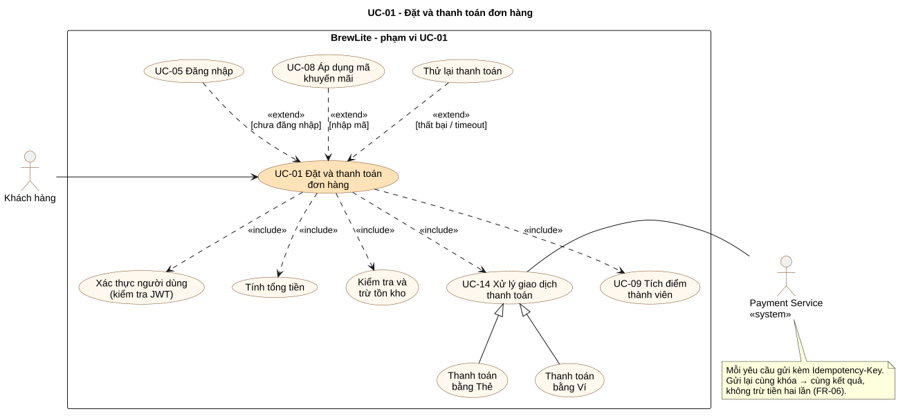

# UC-01 – Đặt và thanh toán đơn hàng (Task 1.3)

| Thuộc tính | Giá trị |
|---|---|
| Tài liệu | `docs/requirements/use-case-checkout.md` |
| Phiên bản | 1.0 |
| Ngày | 2026-11-01 |
| Tài liệu liên quan | [SRS](srs.md) · [Bối cảnh & phạm vi](context-and-scope.md) |
| Sơ đồ | [`usecase-checkout.puml`](../diagrams/usecase-checkout.puml) · [`usecase-checkout.svg`](../diagrams/usecase-checkout.svg) |

**Lý do chọn:** đây là use-case tạo ra doanh thu và đi qua mọi thành phần quan trọng của hệ thống: xác thực, tính giá, tồn kho, transaction, dịch vụ thanh toán bên ngoài, idempotency và loyalty. Nó cũng là phần lõi của luồng bắt buộc *Giỏ hàng → Đặt đơn → Thanh toán → Theo dõi đơn*.

## 1. Sơ đồ use-case cho phạm vi UC-01

## 2. Thông tin chung

| Mục | Nội dung |
|---|---|
| **Mã / Tên** | UC-01 – Đặt và thanh toán đơn hàng |
| **Mức ưu tiên** | Must |
| **Tác nhân chính** | Khách hàng (`CUSTOMER`) |
| **Tác nhân phụ** | Payment Service (hệ thống thanh toán mô phỏng) |
| **Stakeholder và lợi ích** | **Khách hàng:** đặt nhanh, trả đúng tiền, không bị trừ tiền hai lần. **Quản lý:** không bán vượt tồn kho, ghi nhận doanh thu chính xác. **Nhân viên:** chỉ nhận đơn đã thanh toán. **Đơn vị thanh toán:** yêu cầu hợp lệ, có idempotency key. |
| **Trigger** | Khách hàng bấm **"Đặt hàng"** trên màn hình Giỏ hàng (`/cart`). |
| **Tiền điều kiện** | **P1.** Giỏ hàng có ít nhất 1 dòng hợp lệ (FR-03). **P2.** Quán đang hoạt động và API, database sẵn sàng. *(Khách chưa đăng nhập vẫn bắt đầu được use-case; hệ thống xử lý ở luồng A1.)* |
| **Hậu điều kiện – thành công** | **S1.** Có một `Order` ở trạng thái `PAID` với mã `BL-YYMMDD-NNNN` và snapshot giá (BR-06). **S2.** Tồn kho từng sản phẩm đã giảm đúng số lượng đặt. **S3.** Có đúng 1 `Payment` `SUCCEEDED` với `amount = Order.total`, chỉ lưu `cardLast4` nếu trả bằng thẻ. **S4.** Có `LoyaltyTransaction` loại `EARN` (nếu FR-15 đã làm). **S5.** Đơn xuất hiện trên bảng đơn của nhân viên. **S6.** Khách thấy màn hình xác nhận có số gọi món. **S7.** Giỏ hàng đã được xóa. |
| **Hậu điều kiện – thất bại** | **F1.** Không có `Payment` `SUCCEEDED` và khách **không bị trừ tiền**. **F2.** Nếu đơn chưa được tạo thì tồn kho giữ nguyên. Nếu đơn đã tạo thì đơn ở `PENDING_PAYMENT` (còn được thử lại) hoặc `CANCELLED` và tồn kho đã được hoàn. **F3.** Khách thấy lý do thất bại bằng tiếng Việt. |
| **Yêu cầu liên quan** | FR-03, FR-04, FR-05, FR-06, FR-07, FR-10, FR-13, FR-14, FR-15; NFR-04, NFR-05, NFR-13; BR-02 → BR-11, BR-13, BR-14, BR-17, BR-18 |
| **Tần suất** | Cao: khoảng 100–300 đơn/ngày, dồn vào giờ cao điểm |

## 3. Luồng chính (Basic Flow)

| Bước | Tác nhân | Hành động |
|---|---|---|
| 1 | Khách hàng | Ở màn Giỏ hàng, bấm **"Đặt hàng"**. |
| 2 | Hệ thống (UI) | Kiểm tra khách đã đăng nhập và token còn hạn. *(Chưa đăng nhập → A1.)* |
| 3 | Hệ thống (UI) | Hiện màn **Thanh toán** `/checkout`: danh sách món, Tạm tính, ô mã khuyến mãi, chọn phương thức **Thẻ** hoặc **Ví**. |
| 4 | Khách hàng | Chọn phương thức thanh toán và nhập thông tin (thẻ: số thẻ, hạn, CVV; ví: SĐT). *(Nhập mã khuyến mãi → A2.)* |
| 5 | Hệ thống (UI) | Validate dữ liệu ở client (AC-05.2). *(Sai → E1.)* |
| 6 | Khách hàng | Bấm **"Thanh toán …₫"**. |
| 7 | Hệ thống (UI) | Gửi `POST /orders` kèm JWT, `items`, `promoCode?` và `expectedTotal`. |
| 8 | Hệ thống (API) | Xác thực JWT (*hết hạn → E2*), validate body (*sai → E1*). |
| 9 | Hệ thống (API) | Tính lại giá từ database theo BR-02 và BR-04 (*lệch giá → E3*). |
| 10 | Hệ thống (API) | **Mở transaction:** kiểm tra và trừ tồn kho từng sản phẩm (*không đủ → E4*), tạo `Order` (`PENDING_PAYMENT`, `expiresAt = now + 15'`) và các `OrderItem`. **Commit.** |
| 11 | Hệ thống (API) | Trả **201** kèm `orderId`, `code`, `total`, `expiresAt`. |
| 12 | Hệ thống (UI) | Xóa giỏ hàng trên thiết bị. Sinh **`Idempotency-Key`** (UUID v4) cho lần thanh toán này. |
| 13 | Hệ thống (UI) | Gửi `POST /payments` kèm JWT, `Idempotency-Key`, `orderId`, `method` và thông tin thẻ hoặc ví. |
| 14 | Hệ thống (API) | Kiểm tra idempotency key (*đã có → A3*), kiểm tra đơn thuộc khách và đang `PENDING_PAYMENT`, chưa quá hạn (*không → E5*). |
| 15 | Hệ thống (API) | Tạo `Payment` (`PENDING`), gọi **Payment Service** `POST /charges` với cùng `Idempotency-Key`. |
| 16 | Payment Service | Xử lý giao dịch và trả **`SUCCEEDED`**. *(Thất bại → A4; quá 10 giây → A5.)* |
| 17 | Hệ thống (API) | **Một transaction:** `Payment → SUCCEEDED` (lưu `transactionId`, `cardLast4`); `Order → PAID` và ghi lịch sử trạng thái; tăng `Promotion.usedCount` (nếu có); tạo `LoyaltyTransaction EARN`. Lưu response theo idempotency key. |
| 18 | Hệ thống (API) | Trả **201** `{ status: "SUCCEEDED", orderStatus: "PAID" }`. |
| 19 | Hệ thống (UI) | Chuyển tới `/orders/:id`, hiện **"Thanh toán thành công"**, mã đơn, số gọi món, tổng tiền, điểm vừa tích. |
| 20 | Hệ thống | Đơn xuất hiện trên bảng đơn của nhân viên (≤ 5 giây). **Kết thúc use-case.** |

## 4. Luồng thay thế (Alternative Flows)

| Mã | Điều kiện (tại bước) | Xử lý | Quay về |
|---|---|---|---|
| **A1** | Chưa đăng nhập hoặc token hết hạn (bước 2) | 1. UI chuyển tới `/login?returnUrl=/checkout`, **giữ nguyên giỏ hàng**. 2. Khách đăng nhập (UC-05) hoặc đăng ký (UC-04). 3. Đăng nhập thành công thì quay lại `/checkout`. Khách hủy đăng nhập thì use-case kết thúc, giỏ vẫn còn. | Bước 3 |
| **A2** | Khách nhập mã khuyến mãi (bước 4) – UC-08 | 1. UI gọi `POST /promotions/validate`. 2. Hợp lệ thì hiện số tiền giảm và Tổng mới. 3. Không hợp lệ thì hiện lý do (`PROMO_EXPIRED`, `PROMO_MIN_ORDER`…), khách sửa hoặc bỏ mã. | Bước 4 |
| **A3** | Client gửi lại `POST /payments` **cùng `Idempotency-Key`** (bước 14), ví dụ do mất mạng, bấm hai lần hoặc tải lại trang | 1. API tìm thấy kết quả đã lưu theo khóa và trả **đúng response cũ**. **Không gọi lại Payment Service.** 2. Request trước cùng khóa còn đang xử lý thì trả `409 REQUEST_IN_PROGRESS`, UI chờ 2 giây rồi gửi lại. | Bước 18 (hoặc A4) |
| **A4** | Payment Service trả **`FAILED`** (bước 16), ví dụ `CARD_DECLINED`, `INSUFFICIENT_FUNDS`, `WALLET_LOCKED` | 1. API lưu `Payment → FAILED` kèm `failureCode`. Đơn **vẫn `PENDING_PAYMENT`**, tồn kho vẫn giữ. 2. Trả `402 PAYMENT_FAILED`. 3. UI hiện lý do và hai nút **"Thử lại"** và **"Đổi phương thức"**. 4. Khách thử lại với **Idempotency-Key mới**. Nếu đây là lần thất bại thứ 3 thì chuyển E6. | Bước 4 |
| **A5** | Payment Service **không phản hồi trong 10 giây** (bước 16) | 1. API giữ `Payment = PENDING` và trả `202 { status: "PENDING" }`. 2. UI hiện "Đang xử lý thanh toán…" rồi **gửi lại cùng `Idempotency-Key`** sau 3 giây, tối đa 5 lần. 3. API gọi lại Payment Service với cùng khóa và nhận **kết quả của giao dịch cũ** (không tạo giao dịch mới). | Bước 17 hoặc A4 |
| **A6** | Khách quay lại thanh toán một đơn `PENDING_PAYMENT` đã có, từ lịch sử đơn hoặc màn chi tiết | UI mở `/checkout?orderId=…`, bỏ qua bước 7–11. | Bước 12 |

## 5. Luồng ngoại lệ (Exception Flows)

| Mã | Điều kiện (tại bước) | Xử lý của hệ thống | Kết quả |
|---|---|---|---|
| **E1** | Dữ liệu không hợp lệ (bước 5 hoặc 8): số thẻ sai Luhn, thẻ hết hạn, SĐT sai, số lượng ngoài 1–10, quá 3 topping… | Client chặn và báo lỗi tại từng ô. Nếu vẫn tới server thì API trả `400` kèm lỗi từng trường. | Không tạo đơn, không gọi Payment Service. Khách sửa và làm lại từ bước 4. |
| **E2** | JWT thiếu, sai hoặc hết hạn (bước 8 hoặc 14) | API trả `401`. | Chuyển sang A1. |
| **E3** | Giá đã thay đổi so với giá khách thấy (bước 9) | API trả `409 PRICE_CHANGED` kèm giá mới. | UI cập nhật giỏ, hiện "Giá đã thay đổi, vui lòng kiểm tra lại", quay về bước 3. |
| **E4** | **Hết hàng:** một hoặc nhiều món không đủ tồn kho (bước 10), kể cả khi khách khác vừa mua hết | **Rollback** transaction và trả `409 OUT_OF_STOCK` kèm `productIds`. | **Không tạo đơn, không trừ kho.** UI đánh dấu "Hết hàng" trên các dòng đó, khách bớt số lượng hoặc xóa món rồi quay về bước 1. |
| **E5** | Đơn không còn thanh toán được (bước 14): đã `PAID`, đã `CANCELLED` hoặc quá `expiresAt` | API trả `409 ORDER_ALREADY_PAID` hoặc `409 ORDER_NOT_PAYABLE`. | Đã `PAID` thì UI chuyển tới màn xác nhận. Đã hủy hoặc hết hạn thì UI báo "Đơn đã hết hạn" và gợi ý đặt lại. |
| **E6** | Thanh toán thất bại **lần thứ 3** (A4) | Một transaction: `Order → CANCELLED`, **hoàn lại tồn kho**, ghi lịch sử trạng thái. | Use-case kết thúc thất bại (F1–F3). |
| **E7** | Khách bỏ dở và đơn quá 15 phút chưa thanh toán | Bộ hẹn giờ (UC-15) chuyển đơn sang `CANCELLED` và hoàn lại tồn kho. | Use-case kết thúc thất bại. |
| **E8** | API hoặc database lỗi hệ thống (500, mất kết nối) | Transaction rollback. Log lỗi kèm `requestId`. Trả `500` hoặc `503` với thông báo chung. | UI hiện "Có lỗi xảy ra, vui lòng thử lại" và giữ dữ liệu khách đã nhập. Gửi lại thanh toán dùng **cùng Idempotency-Key** nên an toàn. |

## 6. Quy tắc và yêu cầu đặc biệt

- Số tiền thanh toán luôn lấy từ `Order.total` trên server, **không** lấy từ client (BR-05, BR-10).
- Mỗi đơn có tối đa 1 payment `SUCCEEDED`, đảm bảo bằng ràng buộc unique có điều kiện trong database (BR-10).
- Idempotency key có hiệu lực 24 giờ, gắn với người dùng (BR-11).
- Không lưu số thẻ đầy đủ và CVV (BR-18).
- Bước 10 và bước 17 đều là **transaction**. Thất bại giữa chừng thì không để lại dữ liệu nửa vời (NFR-13).

## 7. Liên kết use-case ↔ yêu cầu ↔ tiêu chí chấp nhận

| Phần của UC-01 | Yêu cầu | Tiêu chí chấp nhận dùng để viết test |
|---|---|---|
| Bước 2, A1, E2 | FR-10, NFR-04 | AC-04.1, AC-10.3, AC-10.5 |
| Bước 3, A2 | FR-03, FR-14 | AC-03.3, AC-14.1 → AC-14.3 |
| Bước 5, 8, E1 | FR-04, FR-05, NFR-05 | AC-04.2, AC-05.2 |
| Bước 9, E3 | FR-04 | AC-04.3 |
| Bước 10–11, E4 | FR-04, NFR-13 | AC-04.4, AC-04.5, AC-04.6, AC-04.7 |
| Bước 12–18 | FR-05 | AC-05.1, AC-05.3, AC-05.4, AC-05.8 |
| A3, A5, E8 | FR-06 | AC-05.7, AC-06.1 → AC-06.5 |
| A4, E6 | FR-05, FR-13 | AC-05.5, AC-05.6 |
| E5, E7 | FR-05, FR-13 | AC-05.3, AC-06.5, AC-13.3 |
| Bước 17 (loyalty, promotion) | FR-14, FR-15 | AC-14.4, AC-15.1, AC-15.2 |
| Bước 19–20 | FR-07, FR-12 | AC-07.1, AC-12.2 |

## 8. Kịch bản kiểm thử nghiệm thu (rút từ UC-01)

Những kịch bản này là đầu vào cho integration test và E2E test ở Task 5.

| Mã | Kịch bản | Dữ liệu | Kết quả mong đợi |
|---|---|---|---|
| UAT-01 | Luồng chính bằng thẻ | Thẻ `4242 4242 4242 4242`, 2 ly | Đơn `PAID`, kho −2, 1 payment `SUCCEEDED`, màn xác nhận có số gọi món |
| UAT-02 | Luồng chính bằng ví | SĐT `0912345678` | Như UAT-01 với phương thức Ví |
| UAT-03 | Chưa đăng nhập (A1) | Khách vãng lai có giỏ 1 ly | Chuyển tới đăng nhập, giỏ còn nguyên, quay lại `/checkout` |
| UAT-04 | Hết hàng (E4) | Sản phẩm còn 1, đặt 2 | `409 OUT_OF_STOCK`, không có đơn, kho vẫn 1 |
| UAT-05 | Thẻ bị từ chối (A4) | Thẻ `4000 0000 0000 0002` | `402`, đơn `PENDING_PAYMENT`, thử lại bằng `4242…` thì thành công |
| UAT-06 | Thất bại 3 lần (E6) | 3 lần thẻ `…0002` | Đơn `CANCELLED`, kho được hoàn |
| UAT-07 | Gửi lại cùng khóa (A3) | Gửi 2 lần cùng `Idempotency-Key` | Cùng response, Payment Service được gọi 1 lần, 1 payment |
| UAT-08 | Timeout (A5) | Thẻ `4000 0000 0000 0119` | Lần đầu `202 PENDING`, gửi lại cùng khóa thì `SUCCEEDED` |
| UAT-09 | Mã khuyến mãi (A2) | `GIAM10`, Tạm tính 150.000 | Tổng 135.000, `usedCount` +1 sau khi `PAID` |
| UAT-10 | Đặt đồng thời | 10 khách cùng đặt 1 ly, kho còn 5 | Đúng 5 đơn thành công, kho = 0 |
